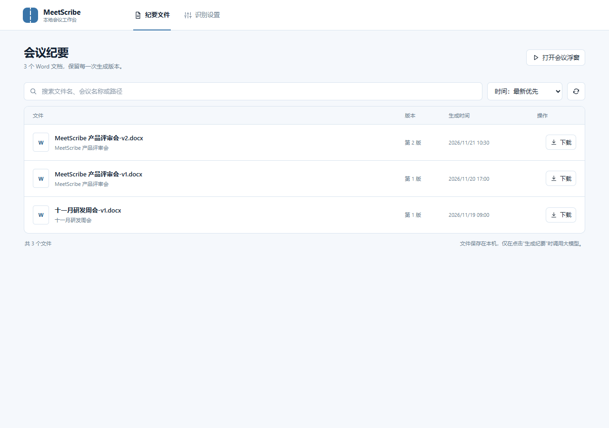
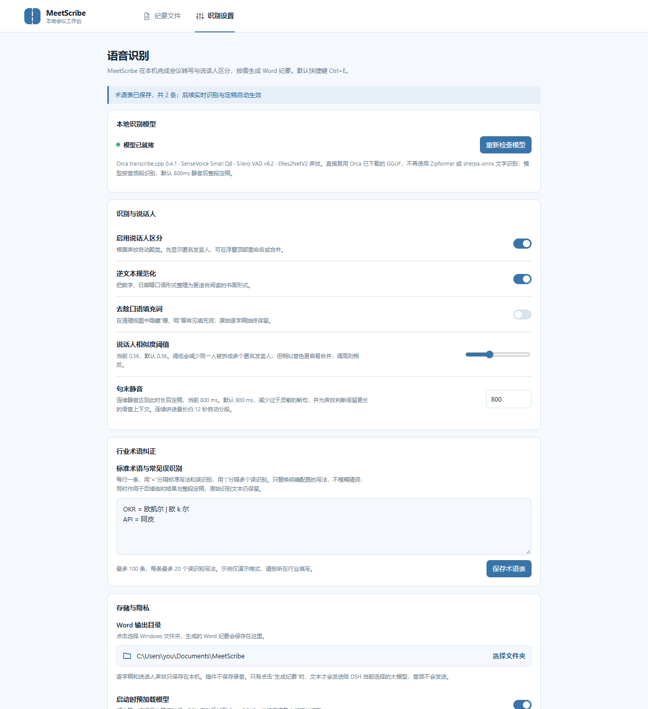
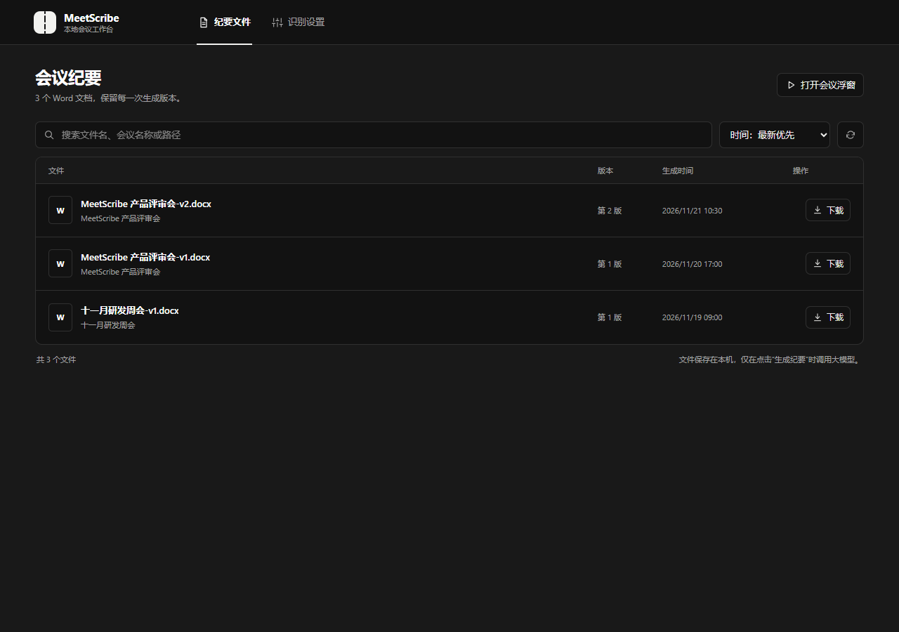
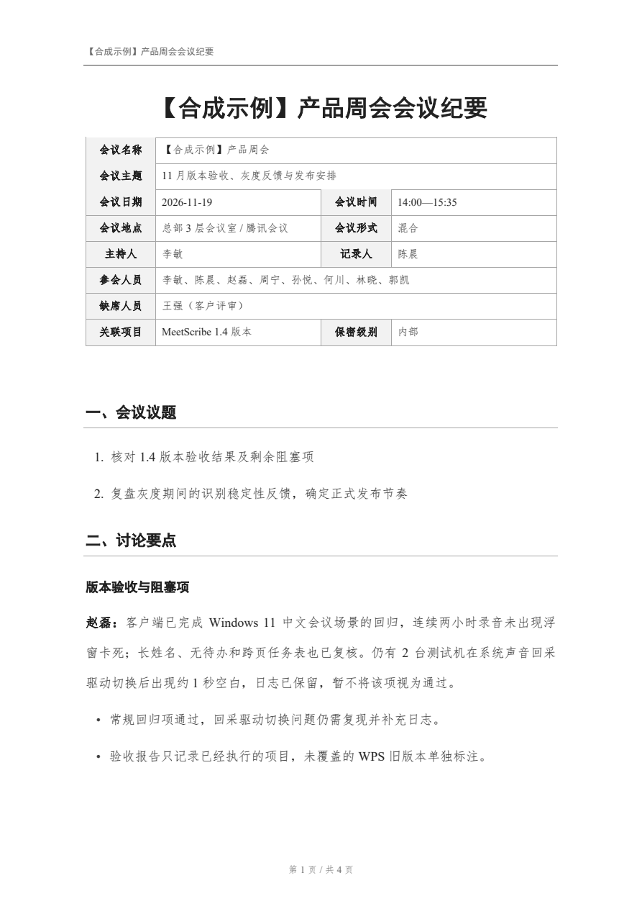

# dsh-meetscribe

面向 **DeepSeek Harness Desktop** 的本地会议转写、说话人管理与 Word 纪要插件。左侧独立工作台集中管理所有纪要版本和识别设置，Ctrl+E 浮窗负责实时记录；只有点击“生成纪要”时，才会调用 Harness 当前选择的大模型。



## 功能总览

### 纪要文件与识别设置集中在工作台

- 点击 Harness 左侧 **MeetScribe** 打开独立主界面，不再从 Harness 设置页进入。
- “纪要文件”汇总全部会议的每一个 Word 生成版本，显示所属会议、版本和生成时间。
- 支持按文件名、会议名称或本机路径搜索，按时间或名称正倒序排列，以及刷新和下载。
- “识别设置”统一管理本地模型、断句、说话人、行业术语、文本清理和 Word 输出目录。

### 打开浮窗即可本地记录

- **Ctrl+E** 唤起 Harness 和录音浮窗，自动使用 Windows 默认麦克风；也可点击输入框旁的 MeetScribe 图标。
- 使用本机 **Orca 已下载的 SenseVoice Small Q8 GGUF + transcribe.cpp 0.4.1** 识别中文、中英混合和英文，不经过云端 ASR。
- 分段期间刷新临时文字，默认 **800ms** 静音后整段定稿；连续讲话约 12 秒自动分段。
- 声波由真实音频电平驱动。顶部纯图标按钮控制暂停/继续、清空和生成纪要，绿色圆点表示正在录音。
- 浮窗支持展开、最小化和浅色/深色主题；收起或最小化不会中断录音。

### 说话人与术语可以修正

- 使用 **ERes2NetV2** 声纹嵌入进行本地在线聚类，默认新建说话人阈值为 **0.56**；只有声纹嵌入仍使用 `sherpa-onnx-node`。
- 展开视图支持说话人改名、合并标签和逐段重新指派。匿名标签不代表真实身份，需人工复核。
- 全局行业术语表按 `标准术语 = 常见误识别` 纠正明确配置的写法，作用于临时结果、整段定稿和纪要输入。
- 原始模型文本与术语纠正后的展示文本分别保存；清理视图可按设置移除口语填充词，不改写原稿。

### 会议和 Word 版本可继续管理

- 支持新建、切换历史会议，补充主题、地点、主持人、参会人等会议信息和人工记录。
- 可清空当前逐字稿，或二次确认后清空全部历史；录音中清空会自动创建空白会议并继续识别。
- 清空历史不会删除输出目录中已经生成的 Word 文件。
- 点击“生成纪要”后生成真正的 `.docx`，包含会议信息、讨论、决议、行动项、未决事项和可选下次会议信息；重新生成会保留版本记录。

## 界面预览

| 浮窗实时记录 | 展开与说话人管理 |
| --- | --- |
|  |  |

| 工作台识别设置 | 深色文档工作台 |
| --- | --- |
|  |  |

[查看 Word 排版示例](docs/samples/meeting-minutes-sample.docx) · [结构化示例数据](docs/samples/meeting-minutes-sample.json)



以上界面图来自真实 React 组件和明确标注的合成数据，不包含用户真实会议或本机文件列表。真实 Orca 模型、Host 转写与持久化验证见 [TESTING.md](TESTING.md)。

## 环境要求

- Windows 10/11 x64（当前主要验证平台）
- DeepSeek Harness Desktop；已在 **0.2.2-rc.5** 实测
- Node.js **22+**（从源码构建时；transcribe.cpp 的最低要求）
- 本机 Orca，且已下载：
  - `SenseVoiceSmall-Q8_0.gguf`
  - `silero-vad-v6.2-F32.gguf`
- 首次准备声纹模型时需联网；生成纪要还需要 Harness 中可用的模型服务

当前验证的是 Orca 1.4.268 下载的 SenseVoice Small Q8。Orca 支持但未下载的 Whisper/Parakeet 不属于本插件当前识别链路。

## 安装

```powershell
git clone https://github.com/everclear077/dsh-meetscribe.git
cd dsh-meetscribe
npm ci
npm run build
dsh plugin --profile desktop add .
```

完全关闭并重新打开 DeepSeek Harness。插件详情页应显示 `dsh-meetscribe`，Harness 左侧和输入框右侧会出现 MeetScribe 波形图标。

> 如果 CLI 不在 PATH 中，可使用 Harness 安装目录下的 `resources\runtime\cli\bin\dsh.cmd`。自定义 profile 时，将 `desktop` 换成实际 profile 名称。

## 首次配置

1. 点击 Harness 左侧 **MeetScribe**，进入 **识别设置**，点击“检查并准备模型”。插件会加载 Orca ASR/VAD GGUF，并按需下载、校验 ERes2NetV2 声纹模型。
2. 句末静音默认 **800ms**，说话人阈值默认 **0.56**。调低阈值会减少同一人被拆分，但也可能合并相似音色。
3. 在“行业术语纠正”中每行填写一条 `标准术语 = 误识别 1 | 误识别 2`，点击“保存术语表”。规则只做确定性替换，不做模糊猜词。
4. Word 默认保存到 `%USERPROFILE%\Documents\MeetScribe`；点击“选择文件夹”可通过 Windows 原生对话框修改输出目录。

如果 Orca 模型缺失，设置界面会显示具体模型位置和修复提示，不会静默退回旧 sherpa ASR。

## 日常使用

1. 按 **Ctrl+E** 或点击输入框旁的波形图标。浮窗会自动创建或继续会议，并请求系统默认麦克风权限。
2. 灰色文字是尚未定稿的临时结果，静音或达到分段上限后保存整段文字。需要时点击顶部 **暂停/继续** 或 **最小化**。
3. 在展开视图中修改说话人、合并误分标签、逐段重新指派，或补充人工记录和会议信息。
4. 暂停后点击 **生成纪要**。只有这一步会把逐字稿、说话人名称和会议信息发送给 Harness 当前选择的大模型。
5. 打开左侧 **MeetScribe → 纪要文件**，搜索、排序、刷新或下载对应 Word 版本。文件仍保存在配置的输出目录，工作台不会复制或移动原文件。
6. 如需重新记录，可使用浮窗顶部 **清空**；历史会议页的 **清空全部** 需再次确认，且不会删除已生成的 `.docx`。

## 隐私与边界

- 麦克风音频只在本机内存中按段处理，**不发送给大模型，也不保存会议音频文件**。
- 会议 JSON 包含逐字稿和声纹嵌入，保存在 `%LOCALAPPDATA%\dsh-meetscribe\meetings`。
- Orca ASR/VAD 权重位于 `%APPDATA%\orca\speech-models`；声纹模型位于 `%LOCALAPPDATA%\dsh-meetscribe\models\speaker`。
- “原始/清理”是本地视图；原始模型文本、术语纠正后的展示文本分别持久化。
- 生成纪要时，文本会发送到 **Harness 当前配置的模型提供方**，其数据政策由对应服务决定。插件不在识别引擎中另存模型密钥。
- 模型只能依据提供的内容整理；未知字段要求标为“待补充/待确认”，但事实、负责人、日期和决议仍需人工复核。

详见 [SECURITY.md](SECURITY.md)。

## 当前限制

- **非原生流式识别**：当前 Orca SenseVoice 不支持 streaming。临时文字来自分段快照，不等同于原生逐字流。
- **识别与声纹仍会出错**：行业词、断句、重叠说话、远场噪声和相似音色可能需要人工修正；术语表不能保证覆盖所有词汇。
- **仅默认麦克风**：不提供应用内设备选择，更换设备需先修改 Windows 默认输入设备。
- **不支持系统声音或混合采集**：当前界面没有该入口；旧 `getDisplayMedia` 路径在 Harness 0.2.2-rc.5 中返回 `Permission denied`。
- **全局热键固定为 Ctrl+E**：若被其他软件占用，冲突会写入 `%LOCALAPPDATA%\dsh-meetscribe-hotkey-error.log`。
- **长会议未做层级总结**：特别长的会议可能受所选 LLM 上下文长度限制。

完整实测记录和未完成的真实 GUI 项目见 [TESTING.md](TESTING.md)。

## 开发

```powershell
npm ci
npm run verify       # TypeScript + 23 项单元测试
npm run sample:word  # 生成 DOCX/JSON 示例
npm run sample:ui    # 验证交互并生成十张组件截图
```

真实 Orca 模型与 Harness Host 复测（输入需为 16 kHz、单声道、PCM16 WAV）：

```powershell
node scripts/smoke-orca-asr.mjs <sample.wav> [...more.wav]
node scripts/smoke-harness-orca.mjs http://127.0.0.1:<host-port> <sample.wav>
```

第二个脚本会创建并最后删除一个明确标记的合成测试会议，不会清空历史会议。

Windows 全局热键助手源码位于 `native/MeetScribeHotkey.cs`。重新构建：

```powershell
Get-Process MeetScribeHotkey -ErrorAction SilentlyContinue | Stop-Process -Force
.\native\build-helper.ps1
```

项目使用 esbuild 产出 Host、Word 入口和 Browser Client；React 与 Harness/Cordis 服务由宿主提供，`transcribe-cpp` 和声纹 native 依赖保持 external。贡献指南见 [CONTRIBUTING.md](CONTRIBUTING.md)。

## 文档

- [产品规范](docs/PRODUCT_SPEC.md)
- [实际技术架构](docs/ARCHITECTURE.md)
- [Word 模板规范](docs/WORD_TEMPLATE_SPEC.md)
- [测试报告](TESTING.md)
- [安全与隐私](SECURITY.md)
- [第三方与模型声明](THIRD_PARTY_NOTICES.md)
- [更新日志](CHANGELOG.md)

## 许可证

[MIT](LICENSE)。复用的 `dsh-voice-mode` MIT 代码及各模型声明见 [THIRD_PARTY_NOTICES.md](THIRD_PARTY_NOTICES.md)。ASR/VAD 权重由 Orca 下载和管理，声纹模型从固定上游下载并校验；模型权重不随本仓库分发。
