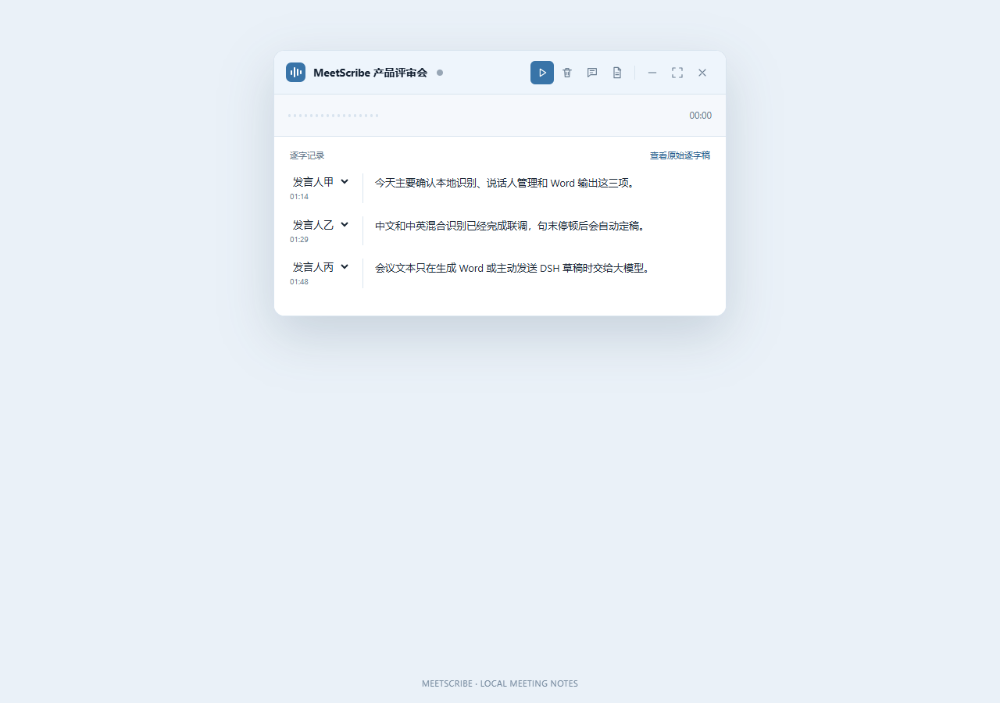

# dsh-meetscribe

面向 **DeepSeek Harness Desktop** 的本地会议转写、说话人管理与 Word 纪要插件。左侧独立工作台集中管理生成任务、所有纪要版本和识别设置，Ctrl+E 浮窗负责实时记录；只有点击“生成纪要”，或在 DSH 对话中检查草稿后主动发送，才会把会议文本交给大模型。Word 路径默认跟随 DSH 当前模型，也可在 MeetScribe 中单独选择。


## 功能总览

### 纪要文件与识别设置集中在工作台

- 点击 Harness 左侧 **MeetScribe** 打开独立主界面，不再从 Harness 设置页进入。
- “纪要文件”汇总全部会议的每一个 Word 生成版本，显示所属会议、版本和生成时间。
- 点击生成后，Host 持有后台任务并广播“准备逐字稿 → DSH 模型整理 → 解析 → 生成 Word”的进度；模型阶段显示实际接收的推理与正文字符数，失败保留实际错误并可重试，完成后可直接下载对应版本。
- 任务独立于浮窗开关和工作台页面切换；同一会议的重复点击复用进行中的任务，不重复调用模型。
- 支持按文件名、会议名称或本机路径搜索，按时间或名称正倒序排列，以及刷新和下载。
- “识别设置”统一管理纪要模型、推理强度、模型无响应超时、本地模型、断句、说话人、行业术语、文本清理和 Word 输出目录。

### 完整的本地模型下载与加载

- 点击“检查并准备模型”后，插件直接从固定官方地址下载所需模型，连接失败时自动尝试内置备用镜像，不依赖其他应用预先安装。
- 文字识别使用 **SenseVoice Small Q8 GGUF + transcribe.cpp 0.4.1**，支持中文、中英混合和英文；语音检测使用 **Silero VAD v6.2 GGUF**，说话人嵌入使用 **ERes2NetV2 ONNX**。
- 三类模型分别保存到插件自己的 `models\asr`、`models\vad` 和 `models\speaker` 目录。
- 下载过程检查每个重定向地址，并验证文件大小和 SHA-256；校验通过后才替换旧文件并加载。
- 已安装且校验通过的文件直接复用，不重复下载；重复点击会复用同一准备任务，界面显示当前文件和进度。
- 启动预加载只加载已经安装的 ASR/VAD，不会静默下载模型。录音中的声纹懒加载也只使用已安装且校验通过的文件，不会隐式下载或阻塞定稿。录音中需先暂停，再安装或修复模型；模型准备期间不能开始或继续录音。

### 纪要模型可独立选择

- “识别设置 → 纪要生成模型”直接读取 DSH 对话模型选择器使用的 `sessionController.modelCatalog()` 目录，保持相同的 Provider 分组、账号/官方 Provider 优先顺序、组内模型顺序及实际支持的推理强度，不维护另一份硬编码或自行枚举的模型清单。
- 默认“跟随 DSH 当前模型”；固定具体 Provider/Model 只影响之后新创建的 Word 纪要任务，不修改 DSH 对话默认模型，也不改变正在运行的任务。
- 插件只持久化 Provider 路由、模型 ID 和可选推理强度，不读取或保存 API Key、OAuth 信息或 Provider 配置。
- 默认无响应超时为 **5 分钟**，可调整为 1–30 分钟。它只计算连续没有任何流事件的等待时间；收到思考、正文或其他事件就重新计时，不再用固定 **120 秒总时限**中止仍在生成的长任务。
- 模型通道不可用或推理强度不受支持时，错误会指向“识别设置”供用户重新选择；其他 Provider 错误仍保留实际 code/message。

### 打开浮窗即可本地记录

- **Ctrl+E** 唤起 Harness 和录音浮窗，自动使用 Windows 默认麦克风；也可点击输入框旁的 MeetScribe 图标。
- 音频只在本机处理，不经过云端 ASR。
- **Silero VAD 主导会议开段**，保留 1.5 秒滚动句首，避免低音量语音被固定音量门限整句过滤；VAD 暂不可用时自动回退 RMS 检测。
- 分段期间刷新临时文字，默认 **800ms** 静音后整段定稿；连续讲话约 12 秒自动分段。
- 声波由真实音频电平驱动。顶部纯图标按钮控制暂停/继续、清空、在 DSH 对话中整理和生成 Word，绿色圆点表示正在录音。
- 浮窗支持展开、最小化和浅色/深色主题；收起或最小化不会中断录音。

### 说话人与术语可以修正

- 使用 ERes2NetV2 声纹嵌入进行本地在线聚类，新安装的默认新建说话人阈值为 **0.65**。已有自定义阈值不会被升级覆盖。
- 只有高置信匹配才更新声纹质心，避免一次边界误并把后续不同声音持续合并；会议中调整阈值和最大人数会从下一段生效，不清空已有声纹历史。
- 展开视图支持说话人改名、合并标签和逐段重新指派。匿名标签不代表真实身份，需人工复核。
- 全局行业术语表按 `标准术语 = 常见误识别` 纠正明确配置的写法，作用于临时结果、整段定稿和纪要输入。
- 原始模型文本与术语纠正后的展示文本分别保存；清理视图可按设置移除口语填充词，不改写原稿。

### 会议和 Word 版本可继续管理

- 支持新建、切换历史会议，补充主题、地点、主持人、参会人等会议信息和人工记录。
- 可清空当前逐字稿，或二次确认后清空全部历史；录音中清空会自动创建空白会议并继续识别。
- 清空历史不会删除输出目录中已经生成的 Word 文件。
- 点击“生成纪要”后在后台生成真正的 `.docx`，包含会议信息、讨论、决议、行动项、未决事项和可选下次会议信息；重新生成会保留版本记录。
- 也可点击“在 DSH 对话中整理”，把完整逐字稿、人工元数据和纪要要求放入 DSH 对话草稿；已有草稿采用追加而非覆盖。插件不自动发送，用户检查后复用 DSH 的模型与对话能力。

## 界面预览

| 浮窗实时记录 | 展开与说话人管理 |
| --- | --- |
|  |  |

| 工作台识别设置 | 深色文档工作台 |
| --- | --- |
|  |  |

[查看 Word 排版示例](docs/samples/meeting-minutes-sample.docx) · [结构化示例数据](docs/samples/meeting-minutes-sample.json)


以上界面图来自真实 React 组件和明确标注的合成数据，不包含用户真实会议或本机文件列表。模型下载、原生加载、Host 转写与持久化验证见 [TESTING.md](TESTING.md)。

## 环境要求

- Windows 10/11 x64（当前主要验证平台）
- DeepSeek Harness Desktop；已在 **0.2.2-rc.5** 实测
- Node.js **22+**（从源码构建时；transcribe.cpp 的最低要求）
- 首次下载模型时需要联网；启用说话人区分时，三类模型合计约 **325 MB**
- 生成纪要需要 Harness 中可用的模型服务

模型权重不随仓库分发，也不需要手动放入其他应用目录。

## 安装

```powershell
git clone https://github.com/everclear077/dsh-meetscribe.git
cd dsh-meetscribe
npm ci
npm run build
dsh plugin --profile desktop add .
```

完全关闭并重新打开 DeepSeek Harness。插件详情页应显示 `dsh-meetscribe`，Harness 左侧和输入框右侧会出现 MeetScribe 波形图标。

> 如果 CLI 不在 PATH 中，可使用 Harness 安装目录下的 `resources\runtime\cli\bin\dsh.cmd`。自定义 profile 时，将 `desktop` 换成实际 profile 名称。

## 首次配置

1. 点击 Harness 左侧 **MeetScribe**，进入 **识别设置**，点击“检查并准备模型”。
2. 插件依次下载并加载 SenseVoice ASR、Silero VAD；启用说话人区分时还会下载并加载 ERes2NetV2。下载完成后应显示“模型已就绪”。
3. 模型默认保存到 `%LOCALAPPDATA%\dsh-meetscribe\models`。已有文件会重新核对大小和 SHA-256，完好的文件不会重复下载。
4. 句末静音默认 **800ms**，新安装的说话人阈值默认 **0.65**。调低阈值会减少同一人被拆分，但也可能合并不同声音；已有自定义阈值保持原值，可在设置中调整。
5. 在“纪要生成模型”中保持“跟随 DSH 当前模型”，或选择固定的模型与推理强度。模型无响应超时默认 5 分钟，持续返回内容的任务不受固定总时长限制。
6. 在“行业术语纠正”中每行填写一条 `标准术语 = 误识别 1 | 误识别 2`，点击“保存术语表”。规则只做确定性替换，不做模糊猜词。
7. Word 默认保存到 `%USERPROFILE%\Documents\MeetScribe`；点击“选择文件夹”可通过 Windows 原生对话框修改输出目录。

如果下载或加载失败，设置界面会显示错误。网络或校验失败不会用未验证文件替换旧模型；临时 `.part` 文件会清理，修复后可重新点击准备。当前不支持断点续传或自定义下载镜像。

## 日常使用

1. 按 **Ctrl+E** 或点击输入框旁的波形图标。浮窗会自动创建或继续会议，并请求系统默认麦克风权限。
2. 灰色文字是尚未定稿的临时结果，静音或达到分段上限后保存整段文字。需要时点击顶部 **暂停/继续** 或 **最小化**。
3. 在展开视图中修改说话人、合并误分标签、逐段重新指派，或补充人工记录和会议信息。
4. 暂停后可任选一种整理方式：
   - 点击 **生成纪要**，把逐字稿、说话人名称和会议信息发送给 MeetScribe 所选纪要模型（默认跟随 DSH），并在后台生成 Word；到左侧 **MeetScribe → 纪要文件** 查看阶段、实际字符进度、失败原因或完成版本。
   - 点击 **在 DSH 对话中整理**，将相同事实来源和 Markdown 纪要要求放入 DSH 对话草稿。检查并主动发送后才调用模型；这条路径不自动生成 DOCX。
5. 在工作台搜索、排序、刷新或下载对应 Word 版本。文件仍保存在配置的输出目录，工作台不会复制或移动原文件。
6. 如需重新记录，可使用浮窗顶部 **清空**；历史会议页的 **清空全部** 需再次确认，且不会删除已生成的 `.docx`。

## 隐私与边界

- 麦克风音频只在本机内存中按段处理，**不发送给大模型，也不保存会议音频文件**。
- 会议 JSON 包含逐字稿和声纹嵌入，保存在 `%LOCALAPPDATA%\dsh-meetscribe\meetings`。
- 模型文件只从固定 HTTPS 地址下载，保存在 `%LOCALAPPDATA%\dsh-meetscribe\models`；下载过程不上传会议内容。
- “原始/清理”是本地视图；原始模型文本、术语纠正后的展示文本分别持久化。
- 生成 Word 时，文本会发送到 **MeetScribe 所选纪要模型的提供方**（默认跟随 DSH）；把会议草稿放入 DSH 对话后主动发送时，使用 DSH 对话当前模型。其数据政策由对应服务决定。仅创建草稿不会自动调用模型。插件不读取或保存模型密钥，独立纪要设置只保存模型路由标识。
- 模型只能依据提供的内容整理；未知字段要求标为“待补充/待确认”，但事实、负责人、日期和决议仍需人工复核。

详见 [SECURITY.md](SECURITY.md)。

## 当前限制

- **非原生流式识别**：SenseVoice 不支持 streaming。临时文字来自分段快照，不等同于原生逐字流。
- **本地模型管理范围固定**：当前使用上述三类固定本地识别模型，不提供自定义模型目录、镜像、断点续传或界面内删除功能。纪要 LLM 的路由选择不属于本地模型下载管理。
- **识别与声纹仍会出错**：当前每个 final 段计算一次声纹，不做段内多人自动切分或重叠语音分离；行业词、断句、重叠说话、远场噪声和相似音色可能需要人工修正。
- **生成任务仅保存在 Host 内存**：关闭浮窗或切换页面不影响任务，但 Harness 进程重启后不会恢复任务列表；已生成的 Word 文件和会议版本仍在磁盘。
- **仅默认麦克风**：不提供应用内设备选择，更换设备需先修改 Windows 默认输入设备。
- **不支持系统声音或混合采集**：当前界面没有该入口；旧 `getDisplayMedia` 路径在 Harness 0.2.2-rc.5 中返回 `Permission denied`。
- **全局热键固定为 Ctrl+E**：若被其他软件占用，冲突会写入 `%LOCALAPPDATA%\dsh-meetscribe-hotkey-error.log`。
- **长会议未做层级总结**：特别长的会议可能受所选 LLM 上下文长度限制。

完整实测记录和未完成的真实 GUI 项目见 [TESTING.md](TESTING.md)。

## 开发

```powershell
npm ci
npm run verify       # TypeScript + 54 项单元测试
npm run sample:word  # 生成 DOCX/JSON 示例
npm run sample:ui    # 验证交互并生成十二张组件截图
```

真实下载三类模型、核对文件并实际加载（目录不存在时会自动创建）：

```powershell
npm run build
node scripts/verify-model-downloads.mjs <model-directory>
```

本地模型与 Harness Host 复测（输入需为 16 kHz、单声道、PCM16 WAV）：

```powershell
node scripts/smoke-local-asr.mjs <sample.wav> [...more.wav]
node scripts/smoke-harness-asr.mjs http://127.0.0.1:<host-port> <sample.wav>
```

第二个脚本会创建并最后删除一个明确标记的合成测试会议，不会清空历史会议。

Windows 全局热键助手源码位于 `native/MeetScribeHotkey.cs`。重新构建：

```powershell
Get-Process MeetScribeHotkey -ErrorAction SilentlyContinue | Stop-Process -Force
.\native\build-helper.ps1
```

项目使用 esbuild 产出 Host、Word 入口和 Browser Client；React 与 Harness/Cordis 服务由宿主提供，`transcribe-cpp` 和声纹 native 依赖保持 external。贡献指南见 [CONTRIBUTING.md](CONTRIBUTING.md)。

## 文档

- [产品规范](docs/PRODUCT_SPEC.md)
- [实际技术架构](docs/ARCHITECTURE.md)
- [Word 模板规范](docs/WORD_TEMPLATE_SPEC.md)
- [测试报告](TESTING.md)
- [安全与隐私](SECURITY.md)
- [第三方与模型声明](THIRD_PARTY_NOTICES.md)
- [更新日志](CHANGELOG.md)

## 许可证

[MIT](LICENSE)。复用的 `dsh-voice-mode` MIT 代码及各模型声明见 [THIRD_PARTY_NOTICES.md](THIRD_PARTY_NOTICES.md)。模型由插件从固定上游下载并校验；模型权重不随本仓库分发。
