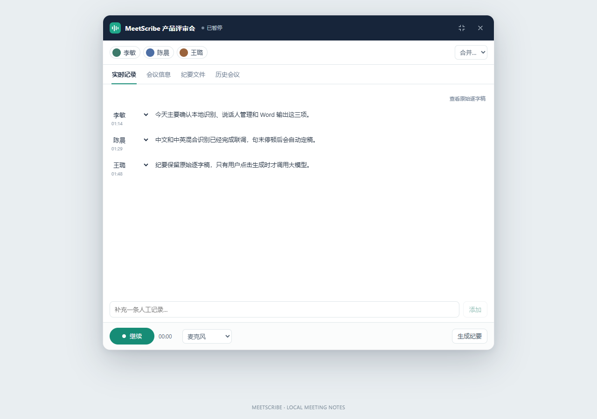
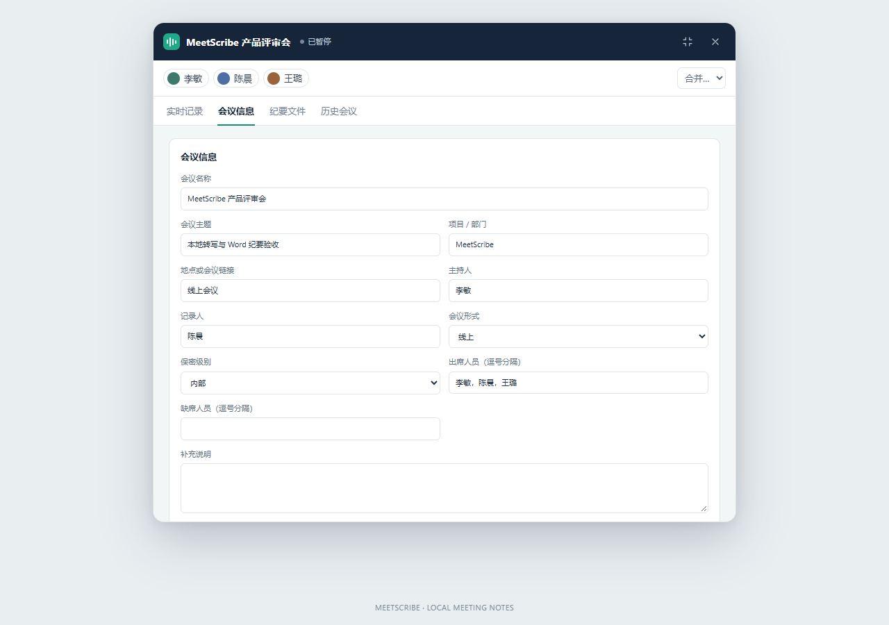
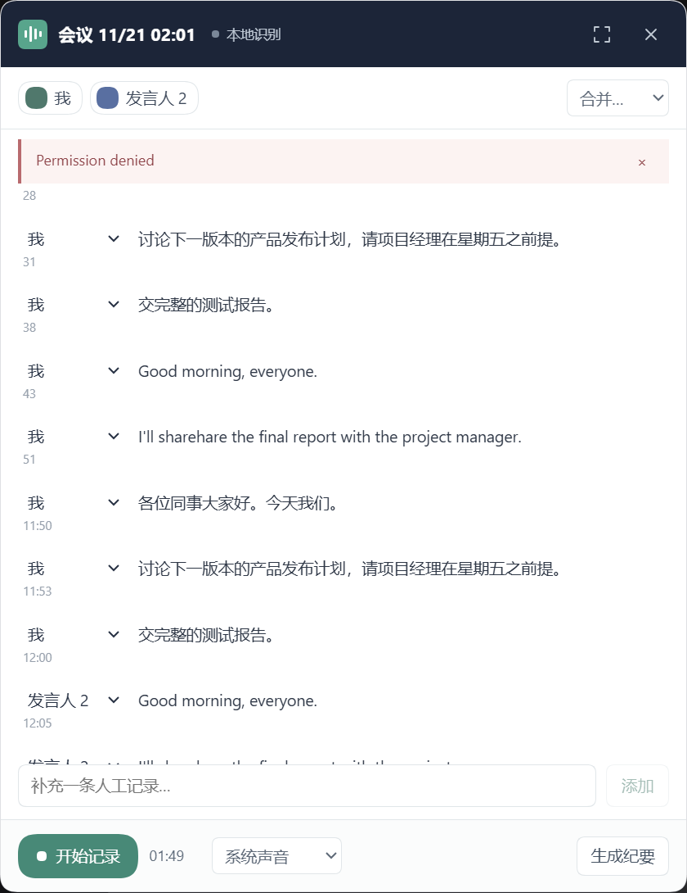

# dsh-meetscribe

面向 **DeepSeek Harness Desktop** 的本地会议转写、说话人管理与原生 Word 纪要插件。默认在电脑本地完成语音识别和声纹聚类；只有点击“生成纪要”时，才把逐字稿与会议信息交给 Harness 当前选择的大模型。


## 功能

- **Ctrl+E 唤起**：Windows 全局热键会把 Harness 带到前台并打开浮窗；也可点击输入框旁的 MeetScribe 图标。
- **本地实时转写**：Streaming Zipformer 提供流式结果，Silero VAD 分段，SenseVoice 进行整句复识别；支持中文和英文。
- **说话人管理**：CAM++ 本地声纹嵌入与在线聚类；支持顶部改名、合并说话人以及逐段重新指派。
- **可追溯文本**：同时保存原始识别文本与清理文本；清理视图只按设置移除常见口语填充词，不改写原稿。
- **会议工作台**：紧凑/展开视图、暂停/继续、人工补充记录、历史会议和会议元数据表单。
- **原生 Word**：生成真正的 `.docx`，包含会议信息、讨论、决议、行动项、未决事项和可选下次会议信息；带页码、固定宽度表格和跨页表头。
- **本地模型管理**：设置页展示模型状态与下载进度，模型下载带 SHA-256 校验。

## 界面与文档示例

| 展开会议面板 | 会议信息 |
| --- | --- |
|  |  |

真实 Harness 桌面端的中英文、双说话人测试：



[查看 Word 排版示例](docs/samples/meeting-minutes-sample.docx) · [结构化示例数据](docs/samples/meeting-minutes-sample.json)


## 环境要求

- Windows 10/11 x64（当前主要验证平台）
- DeepSeek Harness Desktop；已在 **0.2.2-rc.5** 实测
- Node.js 20+（从源码构建时）
- 首次使用需联网下载开源模型；生成纪要还需要 Harness 中可用的模型服务

## 安装

### 从源码安装到 desktop profile

```powershell
git clone https://github.com/everclear077/dsh-meetscribe.git
cd dsh-meetscribe
npm ci
npm run build
dsh plugin --profile desktop add .
```

完全关闭并重新打开 DeepSeek Harness。插件详情页应显示 `dsh-meetscribe`，输入框右侧会出现 MeetScribe 波形图标。

> 如果 CLI 不在 PATH 中，可使用 Harness 安装目录下的 `resources\runtime\cli\bin\dsh.cmd`。自定义 profile 时，将 `desktop` 换成实际 profile 名称。

### 首次配置

1. 打开 Harness 设置，找到 **MeetScribe 会议记录**。
2. 点击下载/检查本地模型，等待 ASR、VAD、SenseVoice 和说话人模型就绪。
3. 按需调整整句静音时长、说话人阈值、最大说话人数、SenseVoice ITN 和填充词清理。
4. Word 默认保存到 `%USERPROFILE%\Documents\MeetScribe`，可在设置中修改。

## 使用

1. 按 **Ctrl+E** 或点击输入框旁的波形图标。
2. 选择“麦克风”，点击 **开始记录** 并授权麦克风。
3. 灰色文字是尚未定稿的识别结果；整句结束后会保存到会议记录。
4. 点击顶部说话人名称可改名；“合并”可合并误分标签；每段左侧下拉框可单独调整说话人。
5. 在展开视图的“会议信息”中填写主题、地点、主持人、记录人、参会人和缺席人。用户填写的信息优先于模型推测。
6. 点击 **结束**，再点击 **生成纪要**。只有这一步会把文本发送给 Harness 当前选择的大模型。
7. 在“纪要文件”中下载版本化 `.docx`；文件也保存在配置的输出目录。

## 隐私与边界

- 麦克风音频在本机内存中按段处理，**不会发送给大模型，也不会写入会议音频文件**。
- 会议 JSON 包含逐字稿和声纹嵌入，保存在 `%LOCALAPPDATA%\dsh-meetscribe\meetings`；模型保存在同目录的 `models` 下。
- “原始/清理”切换是本地视图；清理文本不会覆盖原始文本。
- 生成纪要时，逐字稿、说话人名称和会议元数据会发送到 **Harness 当前配置的模型提供方**，其数据政策由对应服务决定。
- 模型只会依据提供的内容整理。未知字段使用“待补充/待确认”，但仍需人工复核事实、负责人、日期和决议。

详见 [SECURITY.md](SECURITY.md)。

## 当前限制

- **系统声音/混合采集**：代码使用 Chromium `getDisplayMedia`，但 Harness 0.2.2-rc.5 实测直接返回 `Permission denied`，未出现共享选择器。因此当前实测可用路径是麦克风；系统音频需要宿主开放屏幕捕获权限，不能视为已验证功能。
- **全局热键**：Windows 原生助手仅支持 Ctrl+E。若其他软件已占用该组合键，冲突会写入 `%LOCALAPPDATA%\dsh-meetscribe-hotkey-error.log`。
- **识别质量**：实测可出现断句过早、漏字和重复词；通过扬声器播放合成语音的测试结果不等同于真实会议室效果。多人重叠说话、远场噪声和相似音色仍可能误分。
- **说话人标签**是匿名聚类，不是身份识别；请手动改名并复核。
- 当前不做长会议自动分块层级总结；特别长的会议可能受所选 LLM 上下文长度限制。

完整实测记录见 [TESTING.md](TESTING.md)。

## 开发

```powershell
npm ci
npm run verify       # TypeScript + 单元测试
npm run sample:word  # 生成 DOCX/JSON 示例
npm run sample:ui    # 生成三张真实组件 UI 截图
```

Windows 全局热键助手源码位于 `native/MeetScribeHotkey.cs`。重新构建：

```powershell
Get-Process MeetScribeHotkey -ErrorAction SilentlyContinue | Stop-Process -Force
.\native\build-helper.ps1
```

项目使用 esbuild 产出 Host、Worker 和 Browser Client；React 与 Harness/Cordis 服务由宿主提供。贡献指南见 [CONTRIBUTING.md](CONTRIBUTING.md)。

## 文档

- [产品规范](docs/PRODUCT_SPEC.md)
- [实际技术架构](docs/ARCHITECTURE.md)
- [Word 模板规范](docs/WORD_TEMPLATE_SPEC.md)
- [测试报告](TESTING.md)
- [安全与隐私](SECURITY.md)
- [第三方与模型声明](THIRD_PARTY_NOTICES.md)
- [更新日志](CHANGELOG.md)

## 许可证

[MIT](LICENSE)。复用的 `dsh-voice-mode` MIT 代码及各模型声明见 [THIRD_PARTY_NOTICES.md](THIRD_PARTY_NOTICES.md)。模型在运行时从各自上游下载，不随本仓库分发。
